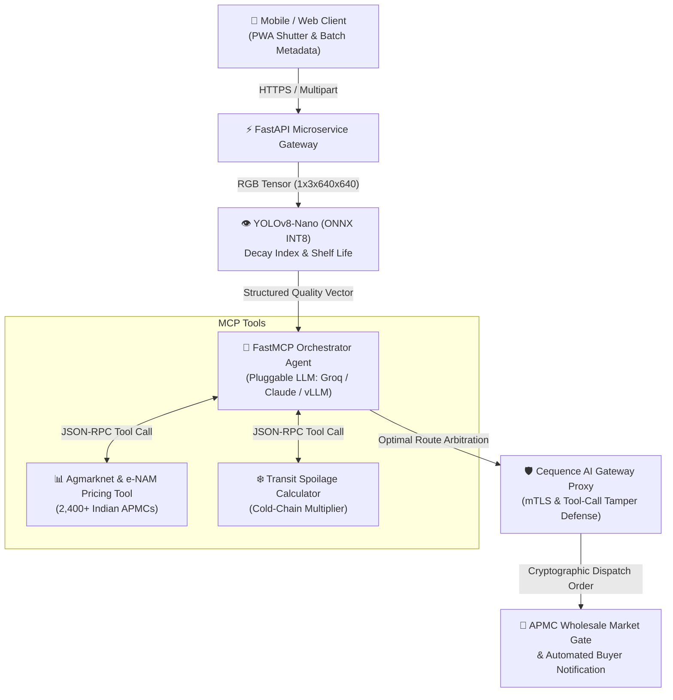

# AgruPulse MCP
**Autonomous Post-Harvest Logistics & Mandi Arbitration Agent**

> An MCP-native autonomous multi-agent platform that evaluates fruit and vegetable degradation via visual edge AI, dynamic cold-chain telemetry, and automated price arbitration across Indian agricultural markets (Mandis).

---

## 🌾 The Problem
- **Massive National Loss**: India yields 353+ Mt of food grains and 367+ Mt of horticulture produce annually. Official ICAR reports to Parliament document **5–15% post-harvest loss in fruits and vegetables** and 4–8% in food grains.
- **Economic Hemorrhage**: Over **74 million tonnes** (~10% of total agricultural output) is lost each year before sale.
- **Asymmetric Vulnerability**: Smallholder farmers suffer disproportionately due to lack of real-time cold-chain monitoring, opaque middleman price spreads, and zero mid-journey rerouting capabilities.
- **The Gap**: Existing crop apps provide only passive disease diagnostics. They do not model transit decay or execute financial market decisions.

---

## ⚡ The AgruPulse Solution
Unlike static advisory tools, **AgruPulse MCP turns computer-vision decay metrics directly into an active financial logistics tool**:
1. **Edge Grading**: Field evaluator or truck driver photographs a produce batch.
2. **Quantized Computer Vision**: An INT8-quantized YOLOv8 model calculates a **decay index (0–100)**, surface browning %, and remaining shelf life (hours).
3. **MCP Tool Orchestration**: An autonomous agent on a FastMCP server queries live wholesale Mandi prices (Agmarknet / e-NAM).
4. **Autonomous Arbitration**: The agent evaluates non-linear distance vs. decay trade-offs, computes net returns after freight fuel surcharges, and issues cryptographically audited dispatch orders.
5. **Dynamic Mid-Transit Rerouting**: If cold-chain telemetry indicates accelerated spoilage mid-journey, the agent automatically diverts the cargo to the nearest viable APMC.

---

## 🛠️ System Architecture



---

## 💻 Tech Stack

| Category | Components |
|---|---|
| **ML & Edge AI** | Google AI Studio (Gemini 3.8 Flash Multimodal Vision), YOLOv8-Nano (PyTorch / ONNX INT8 Quantization), OpenCV |
| **Agent & Protocols** | FastMCP (Python), Model Context Protocol Standard, Pluggable LLM (Gemini 3.8 Flash / Claude 3.5 Sonnet / Groq Llama-3.1-70B) |
| **Agricultural Data** | Agmarknet Public APIs, e-NAM Gateway, Kaggle Freshness Dataset |
| **Backend & Web** | Next.js 16 (App Router), TypeScript, Tailwind CSS, Framer Motion, Recharts |
| **Security & Auth** | Cequence AI Gateway Proxy (API Mediation & Auditing), Descope OAuth (Planned) |

---

## 🚀 Getting Started Locally

### Prerequisites
- Node.js `v18+` (Tested on Node `v24` and `v20`)
- npm `v10+`

### Installation
```bash
# Clone the repository
git clone https://github.com/princepathak1/agrupulse.git
cd agrupulse

# Install dependencies
npm install

# Start development server
npm run dev
```

Visit [http://localhost:3000](http://localhost:3000) for the landing overview and [http://localhost:3000/demo](http://localhost:3000/demo) for the interactive 3-panel simulation.

### Production Build
```bash
npm run build
npm run start
```

---

## 🧪 Interactive Live Demo (`/demo`) Features

The centerpiece `/demo` page provides an end-to-end sandbox:
- **Panel 1 (Capture & Grade)**:
  - 4 built-in produce presets (Tomato, Banana, Mango, Potato, Onion, Apple) rendered in handcrafted vector SVG.
  - Custom image upload with animated laser scanning line and visual bounding boxes.
  - Numerical Decay Index (0–100), surface spoilage percentage, and shelf-life window.
- **Panel 2 (Agent Reasoning Stream)**:
  - Streaming terminal-style typewriter log of FastMCP tool execution (`get_mandi_prices`, `calculate_transit_decay`, `rank_destinations`, `dispatch_order`).
  - Expandable JSON payloads showing tool arguments and return values.
  - Speed controls (`1x`, `2x`, `Fast`) and Cequence AI Gateway cryptographic verification stamps.
- **Panel 3 (Mandi Arbitration & Dynamic Routing)**:
  - Interactive parametric knobs: batch weight (kg), origin freight hub, transport rate (₹/km), and cold-chain toggle.
  - 5-Mandi candidate ranking table highlighting the winner with net return calculations.
  - Visual tabs: Candidate Ranking Table, Comparative Recharts (Net Return & Spoilage vs Hours), and an interactive SVG India route map.
  - **"Simulate Mid-Transit Spoilage" Button**: Simulates a highway reefer compressor failure, causes a decay jump, re-runs the agent, and dynamically reroutes the shipment to save the cargo from total loss.
  - Preview buttons for WhatsApp notifications and Descope OAuth (labeled as planned features).

---

## 🔌 Swapping the Simulated Layer for a Live FastAPI / FastMCP Backend

All data simulation is isolated in `lib/arbitrationEngine.ts` and `lib/mcpSimulator.ts` behind a clean abstraction layer in `lib/api.ts`.

To connect to your real FastMCP / FastAPI server:

1. **Create an environment file** `.env.local`:
   ```bash
   NEXT_PUBLIC_USE_LIVE_API=true
   NEXT_PUBLIC_FASTAPI_URL=http://localhost:8000
   ```

2. **Backend Contract Expected by `lib/api.ts`**:
   - `POST /api/v1/grade-produce`: Accepts `multipart/form-data` with image and commodity string; returns freshness class, decay index, and bounding boxes.
   - `POST /api/v1/arbitrate-mandi`: Accepts JSON payload `{ knobs, preset }`; returns ranked candidate Mandis, reasoning string, and MCP tool call traces.

---

## 🗺️ Product Roadmap

- **Phase 1 (Current MVP)**: Quantized YOLOv8 classifier, FastMCP price lookup tools, distance-decay trade-off engine, and interactive simulation console.
- **Phase 2 (Upcoming)**: Descope OAuth & Passkey authentication securing agent-to-buyer transaction dispatches.
- **Phase 3 (Q3)**: Automated WhatsApp & Twilio dispatch notifications sent to APMC commission agents.
- **Phase 4 (Q4)**: Hardware cold-chain BLE container IoT sensors for real-time ambient temperature and ethylene ppm monitoring.

---

## ⚖️ License & Honesty Disclaimer
- **License**: MIT
- **Data Disclaimer**: Demo runs on simulated illustrative APMC market prices and routing calculations for portfolio and hackathon demonstration purposes.
